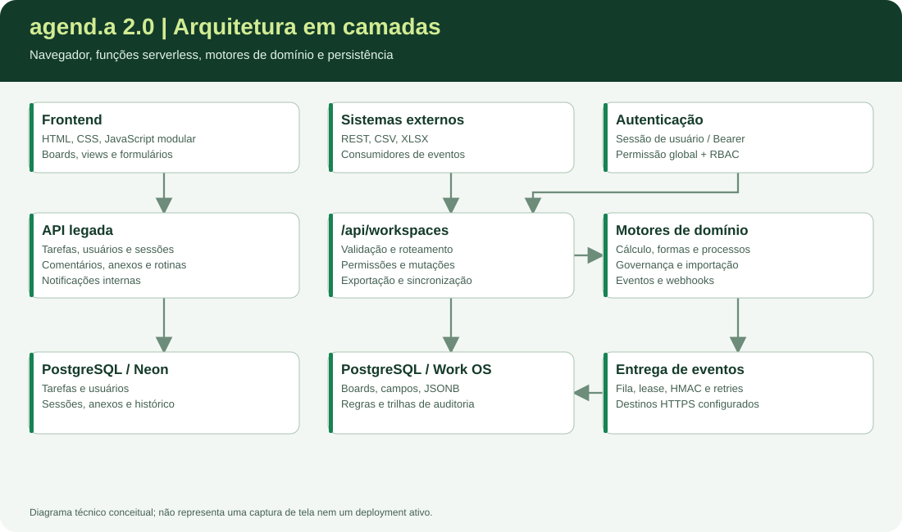
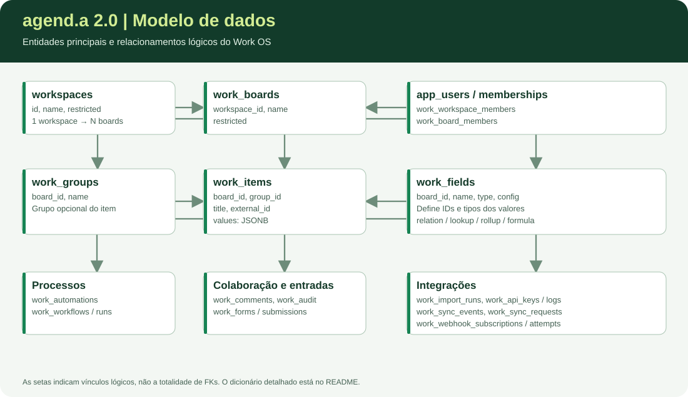
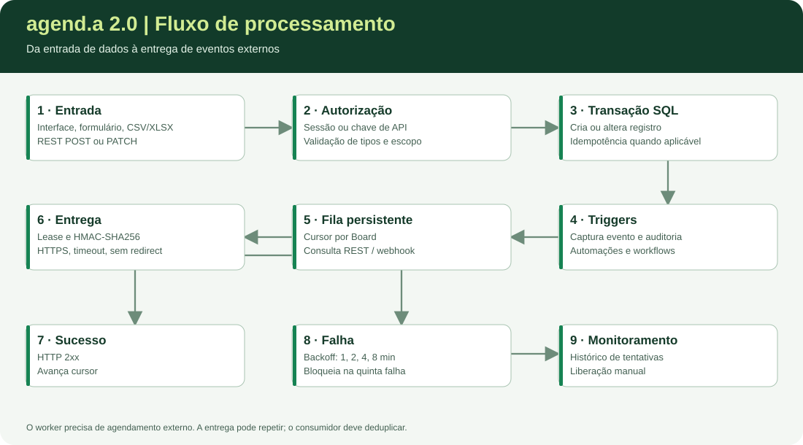
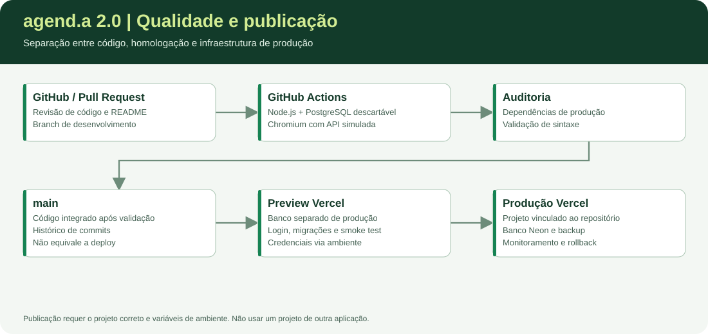

<div align="center">

# ◒ agend.a 2.0

**Work OS · Gestão de atividades, processos, dados e integrações**

Uma plataforma de trabalho modular inspirada na organização dos Work OS: da atividade operacional à automação de processos e inteligência gerencial.


[Funcionalidades](#funcionalidades) · [Arquitetura](#arquitetura) · [Dados](#modelo-de-dados) · [API](#api-rest) · [Instalação](#instalação-e-execução) · [Qualidade](#qualidade-e-publicação)

</div>

## Visão do produto

A agend.a reúne gestão de atividades tradicionais e quadros configuráveis em uma mesma aplicação. Cada quadro possui registros, grupos, campos tipados e visualizações independentes. Os dados podem ser recebidos por formulários, planilhas e API, processados por regras e workflows e apresentados em indicadores.

A aplicação utiliza interface web em português, tema claro/escuro com identidade verde, funções Node.js serverless e PostgreSQL. Não exige um framework de frontend ou um servidor permanente para a aplicação web.

**Estado da versão:** implementação inicial dos módulos abaixo; a aprovação de testes automatizados não equivale à homologação de todos os fluxos com dados reais. O módulo legado permanece separado dos Boards dinâmicos; não há migração automática das tarefas antigas. A disponibilidade em produção depende da configuração do projeto Vercel e do banco correto.

## Funcionalidades

| Módulo | Funcionalidades implementadas | Limites da versão |
|---|---|---|
| Atividades legadas | Visão geral, quadro, Kanban, calendário, rotinas recorrentes, relatórios, checklists, comentários, histórico e anexos | Permissões globais; estrutura separada dos Boards |
| Workspaces e Boards | Ambientes, quadros, grupos, registros, campos configuráveis, modelos | Administração centralizada; sem organizações multi-tenant |
| Tabela | Edição inline, pesquisa sem acentos, filtros por grupo/status, ordenação, paginação de 25/50/100 | Paginação local; não reduz todo o payload de rede |
| Kanban | Status em colunas, movimentação por arraste ou seletor, comentários | Usa o primeiro campo de status |
| Calendário | Grade mensal, campo de data selecionável, navegação por mês | Semana/dia no módulo legado; Board dinâmico mensal |
| Gantt | Datas de início/fim, duração inclusiva, conflitos de dependências | Sem caminho crítico ou reprogramação automática |
| Workload | Agrupamento por responsável textual, esforço, capacidade e sobrecarga | Capacidade uniforme; sem cadastro de disponibilidade |
| Dashboards | KPIs de diversos Boards, resumo por status e campos numéricos | Até 20 indicadores; preferências no navegador |
| Dados relacionais | Relation, Lookup, Rollup, fórmulas aritméticas | Sem fórmulas encadeadas ou código arbitrário |
| Automations | Gatilhos por criação/alteração, condições e ações | Uma ação por regra; sem cascata |
| Workflows | Etapas ordenadas, decisões Sim/Não, ações, histórico e rollback | Sem canvas livre, aprovação humana persistente ou espera |
| Forms | Formulário autenticado, campos obrigatórios, grupo de destino, protocolo | Sem acesso anônimo ou edição de definições publicadas |
| Governança | Perfis por workspace/Board, validação no servidor, auditoria | Não é isolamento completo por organização ou RLS |
| Colaboração | Comentários e menções em registros dinâmicos | Anexos dinâmicos e grupos de usuários pendentes |
| Planilhas | CSV/TSV e XLSX, mapeamento, prévia, importação e exportação | Importação cria registros; sem upsert por planilha |
| API REST | Chaves restritas, GET, POST, PATCH, paginação, idempotência | Sem exclusão externa |
| Eventos e webhooks | Feed por cursor, entrega assinada, retries, monitoramento | Destinos e agendador dependem de infraestrutura |

### Como organizar o trabalho

1. Crie um Workspace para a equipe ou departamento.
2. Crie um Board vazio ou use um dos modelos: Projetos, Rotinas operacionais ou Solicitações.
3. Configure grupos e campos de acordo com o processo.
4. Defina os acessos antes de adicionar dados confidenciais.
5. Insira registros pela tabela, formulário, planilha ou API.
6. Configure automações e workflows somente depois de validar seus efeitos.
7. Acompanhe prazos, indicadores e carga nas visualizações.

A navegação de cada Board agrupa **Visualizações**, **Operações** e **Administração**. As ações em massa permitem mover grupo, alterar status e excluir até 100 registros, conforme o perfil. A seleção é validada antes da mutação no SQL.

## Arquitetura



### Camadas e responsabilidades

| Camada | Tecnologia / arquivos | Responsabilidade |
|---|---|---|
| Interface | `dist/index.html`, CSS e módulos JS | Autenticação visual, navegação, edição e relatórios |
| Estado do Board | `dist/workspaces.js`, `board-core.js`, `board-experience.js` | Dados autorizados, filtros, tabela, Kanban e operações |
| Visualizações | `analytics-core.js`, `advanced-views.js` | Calendário, cronograma, capacidade e KPIs |
| API | `api/workspaces.js`, APIs legadas em `api/` | Roteamento, autenticação, validação e persistência |
| Segurança | `api/_core.js`, `lib/work-access.js`, `work-governance-db.js` | Sessões, permissões, filtragem e auditoria |
| Cálculos | `lib/work-calculations.js` | Relações e resultados derivados |
| Processos | `work-automation-*.js`, `work-workflow-*.js`, `work-form-*.js` | Regras, etapas, submissões e triggers |
| Integrações | `work-exchange-db.js`, `work-xlsx.js`, `work-api-*.js`, `work-sync-db.js`, `work-webhook-*.js` | Importação, API externa, eventos e entregas |
| Persistência | PostgreSQL via `@neondatabase/serverless` | Dados, integridade, transações e histórico |
| Arquivos legados | `@vercel/blob` | Anexos das tarefas tradicionais |

A API carrega apenas dados de Boards autorizados e deriva cálculos no servidor. O frontend usa os dados resultantes para construir as visualizações. As preferências de dashboard são locais ao navegador; não representam uma configuração compartilhada.

### Organização do código-fonte

```text
Agend.a/
├── api/                       # Funções HTTP Vercel e núcleo de sessão
│   ├── _core.js                # Banco, autenticação e bootstrap legado
│   ├── auth.js
│   ├── tasks.js
│   └── workspaces.js           # Entrada principal do Work OS
├── dist/                      # Frontend servido pela Vercel
│   ├── index.html
│   ├── security.js
│   ├── workspaces.js
│   ├── board-core.js
│   ├── board-experience.js
│   ├── board-experience.css
│   ├── analytics-core.js
│   ├── advanced-views.js / advanced-views.css
│   ├── automations.js / workflows.js / forms.js
│   ├── governance.js
│   ├── exchange-core.js / exchange.js
│   └── api-keys.js / webhooks.js
├── lib/                       # Regras, migrações e operações de domínio
├── test/                      # Testes Node.js e PostgreSQL descartável
├── e2e/board.spec.js           # Smoke test Chromium com API simulada
├── docs/images/               # Diagramas SVG versionados
├── .github/workflows/         # CI: testes, navegador e auditoria
├── package.json
└── vercel.json
```

Os nomes unidos por barras acima indicam arquivos separados. Os diagramas são representações técnicas originais da estrutura, não screenshots da aplicação em produção.

## Modelo de dados



### Entidades e relacionamentos

| Entidade | Responsabilidade e vínculo |
|---|---|
| `workspaces` | Ambiente de trabalho; pode ser compartilhado ou restrito |
| `work_boards` | Pertence a um workspace |
| `work_groups` | Classificação opcional dos registros de um Board |
| `work_fields` | Definição de campo por Board; tipo e configuração JSONB |
| `work_items` | Registro com título, Board, grupo, valores JSONB e identificador externo opcional |
| `work_workspace_members` / `work_board_members` | Perfis de usuários por escopo |
| `work_comments` | Comentários associados a registros |
| `work_audit` | Eventos de auditoria e autor quando identificável |
| `work_automations` / `work_automation_runs` | Regras e histórico de execução |
| `work_workflows` / `work_workflow_runs` | Fluxos, etapas e histórico |
| `work_forms` / `work_form_submissions` | Definições e respostas originais |
| `work_import_runs` | Lotes importados e controle de repetição |
| `work_api_keys` / `work_api_requests` / `work_api_logs` | Credenciais, requisições idempotentes e logs |
| `work_sync_requests` | Idempotência de sincronizações PATCH |
| `work_event_counters` / `work_sync_events` | Sequência e eventos persistentes por Board |
| `work_webhook_subscriptions` / `work_webhook_attempts` | Inscrições, leases, cursores e tentativas de entrega |
| `app_users` / `app_sessions` | Usuários e sessões compartilhados com o módulo legado |
| `tasks` e tabelas auxiliares | Atividades tradicionais e sua colaboração |

Campos dinâmicos são armazenados por ID em `work_items.values`:

```json
{"12":"Em andamento","15":250.5,"18":false,"21":"2026-12-01"}
```

A definição do campo determina o tipo e a validação. A chave do campo não depende de sua posição na interface. IDs de grupos e relações são validados contra seus Boards. As migrações são aditivas e inicializadas pelas primeiras chamadas autenticadas; não substituem um backup nem uma revisão de migração em preview.

### Campos e cálculo

| Tipo | Armazenamento / lógica |
|---|---|
| Texto | String, até 2.000 caracteres |
| Número | Número finito |
| Data | ISO AAAA-MM-DD, com validação de calendário |
| Checkbox | Booleano verdadeiro/falso, distinto de vazio |
| Status | A fazer, Em andamento, Concluído ou vazio |
| Relation | IDs de até 200 registros de um Board de destino |
| Lookup | Lista de valores básicos ou títulos dos relacionados |
| Rollup | Contagem, soma, média, mínimo ou máximo |
| Fórmula | Dois campos numéricos locais com +, -, *, / |

Resultados derivados não são editáveis e são recalculados no carregamento. Dados ausentes ou divisão por zero produzem resultado vazio quando aplicável. Relações excluídas são ignoradas; não há limpeza física automática de todos os IDs antigos. Relações para quadros inacessíveis e seus campos derivados são ocultados.

## Processos e entrada de informações



### Automações

As regras são configuradas por administradores para criação de registro ou mudança de campo editável. Uma condição de status pode limitar a execução. A ação pode alterar status, mover grupo, criar registro no mesmo Board ou emitir notificação interna genérica a um destinatário autorizado. As regras usam o evento original e são executadas em ordem de ID; alterações automáticas não provocam cascata. Falhas de uma ação são isoladas.

### Workflows

O editor permite até 10 etapas, com ações e condições de status, caminhos Sim/Não, até 5 ações por caminho e 20 ações configuradas por fluxo. As etapas são avaliadas sequencialmente; as condições podem considerar efeitos anteriores. Cada fluxo executa em subtransação PostgreSQL: se falhar, as ações daquele fluxo são revertidas, preservando a operação que o originou. Histórico de execução e rastreabilidade ficam disponíveis aos administradores.

### Formulários

Seleção de até 30 campos básicos adicionais, título obrigatório, descrição e grupo de destino. O usuário autenticado com criação pode responder via aba Formulários ou link interno `?form=ID`. Cada envio grava o item e suas respostas originais em uma operação atômica. UUID protege contra reenvio da mesma submissão; o protocolo identifica o envio mesmo que o item seja alterado posteriormente. As respostas disparam gatilhos de criação.

### Planilhas

| Recurso | CSV/TSV | XLSX |
|---|---|---|
| Importação | 200 registros, 100 colunas, 500 mil caracteres | Primeira aba, mesmos limites, 1,5 MB compactados e 12 MB descompactados |
| Prévia | Mapeamento, até 10 registros e 100 erros exibidos | Mesmo motor de validação |
| Exportação | Até 10 mil registros / 3,5 MB | Até 5 mil registros, 100 campos / 2,5 MB |
| Segurança | Neutralização de textos interpretáveis como fórmulas na exportação | Rejeição de fórmulas, células especiais, arquivos protegidos e objetos incorporados na importação |

O lote só é gravado após a validação; a criação e o histórico do lote compartilham uma instrução SQL. CSV usa UTF-8 com BOM na exportação. XLSX preserva tipos básicos e aplica cabeçalho verde, filtros e primeira linha congelada. A importação é de inclusão, não atualização por chave; o upsert está disponível na API.

## Segurança e governança

| Perfil | Consulta e comentários | Criação e edição | Exclusão | Administração |
|---|:---:|:---:|:---:|:---:|
| Administrador | Sim | Sim | Sim | Sim |
| Gestor | Sim | Conforme flags globais | Conforme flag global | Não |
| Editor | Sim | Conforme flags globais | Não | Não |
| Leitor | Sim | Não | Não | Não |

O perfil efetivo corresponde ao menor nível entre o Workspace e o Board. Escopos restritos exigem um membro explícito; escopos compartilhados mantêm o acesso anterior. A remoção de uma permissão explícita em um ambiente compartilhado restaura o perfil padrão. Administradores mantêm acesso global.

- Sessões autenticadas, senhas com scrypt e salt e tokens de sessão armazenados como hash.
- Validação de permissões no servidor, incluindo ID direto, formulários, importação, alterações em massa e relações.
- Notificações dos Boards dinâmicos usam conteúdo genérico para reduzir vazamento de informações.
- Auditoria administrativa de registros, comentários e permissões, sem trilha completa de todos os valores antes/depois.
- Chaves REST aleatórias de 256 bits, armazenadas como SHA-256; a chave original aparece uma vez.
- Segredos de banco, chaves e webhooks devem permanecer exclusivamente em variáveis de ambiente ou gerenciadores de segredos.
- Os Boards novos e existentes começam compartilhados. Restringir antes de inserir informações confidenciais.
- O módulo legado não utiliza o RBAC por Board. Não considerar esta versão um SaaS multi-tenant isolado.

## API REST

Endpoint: `/api/workspaces`. Utilize HTTPS e o cabeçalho `Authorization: Bearer SUA_CHAVE`. As chaves são geradas pelo administrador na aba API e integrações, possuem um Board e usuário responsável, expiram em 1–90 dias e podem ser revogadas. O usuário precisa manter as permissões necessárias.

| Método | Operação | Escopo |
|---|---|---|
| GET `?limit=100&after=0` | Lista campos básicos, grupos e registros paginados | read, read_create, read_write |
| GET `?events=1&after=0&limit=100` | Feed de alterações por cursor | read, read_create, read_write |
| POST | Cria registro | read_create, read_write |
| PATCH | Cria ou atualiza por external_id | read_write |

Limite de 60 requisições por minuto por chave; respostas grandes exigem paginação menor. HTTP 429 indica que o consumidor deve aguardar antes de repetir. A API externa não expõe campos calculados ou relações. Logs registram método/status sem token ou payload, mas não incluem todas as tentativas rejeitadas.

### Consulta de registros

```http
GET /api/workspaces?limit=100&after=0
Authorization: Bearer SUA_CHAVE
```

Use `next_after` para continuar até retornar nulo.

### Criação

```json
{
  "title": "Solicitação de material",
  "request_id": "00000000-0000-4000-8000-000000000001",
  "values": {"12":"A fazer","15":250}
}
```

### Sincronização (upsert)

```json
{
  "external_id": "ERP-001",
  "title": "Solicitação de material",
  "request_id": "00000000-0000-4000-8000-000000000002",
  "values": {"15":300}
}
```

Envie via PATCH. O identificador externo é único por Board, sensível a maiúsculas/minúsculas e limitado a 120 caracteres. Campos omitidos são preservados, nulo explícito limpa um valor, grupo omitido permanece. O título é obrigatório. Um novo UUID representa uma nova operação; repita o mesmo UUID ao reenviar após erro de rede. Não há associação automática a registros antigos sem identificador externo. A API não oferece exclusão externa.

### Feed e webhooks

Cada Board tem contador transacional e eventos `created`, `updated`, `deleted`. O consumidor guarda o cursor textual e só avança após processar os eventos; use `has_more` para paginar. O feed não é retroativo nem mantém snapshots completos de valores.

Os webhooks enviam metadados mínimos do evento a destinos HTTPS preconfigurados, com HMAC-SHA256 e ID de entrega estável. Cabeçalhos: `X-Agend-Delivery`, `X-Agend-Timestamp`, `X-Agend-Signature`. A assinatura cobre timestamp, ponto e corpo exato. O consumidor deve verificar assinatura e deduplicar IDs.

O worker usa lease de 60 segundos, timeout de 5 segundos e não segue redirects. O cursor avança após sucesso HTTP 2xx. Falhas são reprogramadas em 1, 2, 4 e 8 minutos; a quinta falha bloqueia a inscrição. A entrega é pelo menos uma vez, não exatamente uma vez. O administrador pode retomar e liberar tentativas manualmente. Não há retenção automática de eventos ainda.

Para processamento automático, configure um agendador externo para POST `/api/workspaces?worker=webhooks`, autenticado pelo segredo separado do worker. Uma chamada processa no máximo um evento. A interface não permite registrar URLs arbitrárias; a infraestrutura deve garantir destinos e DNS/egress confiáveis. Sem destinos ou agendador configurados, a entrega automática não estará ativa.

## Instalação e execução

### Requisitos

Node.js 22, npm, PostgreSQL compatível com Neon (o ambiente de CI usa PostgreSQL 16) e Vercel CLI para desenvolvimento das funções serverless.

```bash
npm install
npm test
npx vercel dev
```

Configure as variáveis de ambiente no projeto correto, separadas entre desenvolvimento, Preview e Production:

| Variável | Uso |
|---|---|
| `DATABASE_URL` | Conexão PostgreSQL/Neon. Obrigatória. |
| `ADMIN_INITIAL_PASSWORD` | Senha inicial do administrador definido no bootstrap, usada somente quando a tabela de usuários está vazia |
| `BLOB_READ_WRITE_TOKEN` | Armazenamento dos anexos legados, quando configurado |
| `AGEND_WEBHOOK_DESTINATIONS` | JSON de aliases para URL HTTPS e segredo; opcional |
| `AGEND_WEBHOOK_WORKER_SECRET` | Segredo independente do worker, mínimo de 32 caracteres; opcional |
| `AGEND_TEST_DATABASE_URL` | Somente CI/teste local descartável; nunca apontar para produção |

Exemplo de formato de configuração de webhooks (valores fictícios, não usar em produção):

```json
{"erp":{"url":"https://example.com/hook","secret":"SUBSTITUIR_POR_SEGREDO_ALEATORIO_SEGURO"}}
```

No primeiro acesso, o bootstrap legado cria as tabelas e pode inserir dados demonstrativos quando a tabela de tarefas está vazia. A criação inicial do administrador depende da variável de senha e do usuário definido no código. Não reutilize senhas de produção em testes.

## Qualidade e publicação



A pipeline `Work OS validation` possui três jobs:

| Job | Cobertura |
|---|---|
| validation | Sintaxe JS, testes nativos Node.js e PostgreSQL 16 descartável |
| browser | Chromium com Playwright e API simulada: navegação, filtros, paginação, seleção e Kanban |
| dependency-audit | Auditoria de dependências de produção, bloqueio de vulnerabilidades altas |

Na revisão de código validada antes desta documentação, o GitHub Actions confirmou **47 testes aprovados, 0 falhas, 0 ignorados**, sucesso do teste Chromium e **0 vulnerabilidades reportadas** pela auditoria. [Evidência da execução](https://github.com/FortunatoE/Agend.a/actions/runs/45616436248). Isso não garante ausência de vulnerabilidades futuras nem substitui testes end-to-end com o banco real.

### Testes locais

```bash
npm test
npm install --no-save --package-lock=false pg@8
# Configure AGEND_TEST_DATABASE_URL somente para banco local agend_test
npm test
npm install --no-save --package-lock=false @playwright/test@1.56.1
npx playwright install chromium
npx playwright test e2e/board.spec.js --workers=1
npm audit --omit=dev --audit-level=high
```

O teste PostgreSQL recusa URLs fora de localhost/127.0.0.1 com o nome de banco `agend_test`. Sem a variável, é ignorado. As verificações com banco usam fixture mínima e rollback; não devem ser executadas em banco de produção.

### Checklist de release

1. Verificar o commit exato, pipeline, auditoria e revisão de segurança.
2. Confirmar projeto Vercel associado a `FortunatoE/Agend.a` e branch de produção `main`.
3. Configurar Preview com banco separado e validar login, migrações, operações legadas, dados dinâmicos, permissões e integrações.
4. Fazer backup do banco real; verificar o plano de migração e rollback.
5. Publicar a revisão aprovada no projeto correto e verificar URL, logs e disponibilidade.
6. Configurar destinos/agendador apenas se forem utilizados, com autorização e segredos apropriados.

O merge no GitHub é uma atualização de código; **não é confirmação de deploy**. A produção precisa ter um projeto e banco autorizados.

## Limitações e roadmap

- Paginação de rede, cache, carregamento por Board, retenção de eventos e testes de volume/concorrência.
- Isolamento completo por organização, grupos de usuários e anexos em Boards dinâmicos.
- Aprovações humanas, agendamento, edição de workflows/formulários publicados e canvas gráfico.
- Dashboard com gráficos configuráveis e preferências sincronizadas entre dispositivos.
- Upsert via planilha, conectores específicos Microsoft 365/e-mail e inteligência artificial.
- Homologação completa com autenticação e banco reais em Preview; teste e monitoramento do ambiente publicado.

O repositório mantém a implementação incremental, as regras de domínio testáveis e os diagramas versionados. Consulte [Pull Request #1](https://github.com/FortunatoE/Agend.a/pull/1) e [GitHub Actions](https://github.com/FortunatoE/Agend.a/actions) para histórico e resultados.

## Product Experience — atualização visual

A camada `dist/product-experience.css` centraliza os tokens da interface (paleta verde, contraste, estados, espaçamento e componentes) e sobrescreve estilos antigos sem remover as visualizações existentes. `dist/product-experience.js` contém a biblioteca local de ícones SVG de traço uniforme, a navegação agrupada/recolhível, a busca, os indicadores operacionais e os recursos de acessibilidade. Os SVGs são definidos localmente, sem dependência externa ou fonte de ícones.

- Navegação com rótulos, ícones, identificação da página ativa e preferência de recolhimento local. Em telas estreitas, o menu continua acessível por rolagem horizontal.
- Busca por atividades legadas e nomes de Boards autorizados, com pesquisa sem acentos e atalho Ctrl/Cmd+K; não pesquisa o conteúdo dos registros dinâmicos.
- Visão geral com KPIs clicáveis e filtros na tabela, distribuição exclusiva por status e próximas entregas. Atraso é uma condição de prazo independente do status.
- Detalhe de atividade e notificações em painéis laterais, com foco confinado ao diálogo, Escape e restauração de foco. Formulários existentes permanecem em modais.
- Relatórios usam responsáveis reais e nomes presentes nos dados, não colaboradores fictícios fixos. As barras de atividades abertas são relativas à maior contagem, não à capacidade de horas.
- Campos e ações com rótulos, botões destrutivos diferenciados, estados de carregamento de quadros, erro recuperável, aviso de sucesso/erro e proteção contra envios duplicados no login e na criação de atividades.
- O teste Chromium de experiência cobre navegação, ícones, indicadores, busca, diálogo, painel lateral e viewport móvel com API simulada.

Não altera tabelas, permissões ou regras de negócio. A remodelação é incremental: a unificação completa do módulo legado com Boards, o editor gráfico de workflows, a revisão integral dos formulários e a auditoria WCAG completa com leitores de tela ainda são evoluções futuras. Validar em Preview antes da publicação.

## Agenda individual e acompanhamento administrativo

O módulo legado de atividades passa a utilizar `tasks.assignee_id` como vínculo ao usuário, em vez de conceder acesso por nome textual. A migração aditiva associa nomes existentes que correspondem de forma única (ignorando espaços externos e diferenças de caixa) a um usuário cadastrado. Nomes sem correspondência ou duplicados permanecem sem vínculo e visíveis apenas aos administradores. A associação é realizada uma vez; o administrador pode corrigir o vínculo pelo painel de detalhes da atividade. Novas atividades de colaboradores são atribuídas a eles próprios; administradores podem selecionar usuários ativos. As flags de criação, edição e exclusão continuam aplicáveis. A próxima ocorrência de uma rotina herda o ID do responsável.

A API filtra as tarefas no servidor e verifica o vínculo nos endpoints de detalhes, checklist, comentários, upload, download, alteração e exclusão. Notificações legadas vinculadas a tarefas também respeitam o acesso atual. A interface mantém filtragem defensiva e restringe visão geral, quadro, Kanban, calendário, rotinas, pesquisa e relatórios às atividades do usuário. Administradores conservam visão global. Os Boards dinâmicos preservam seu modelo de permissões por Workspace/Board (não são convertidos em atividades pessoais).

A aba de calendário **Equipe · mensal**, exclusiva de administradores, apresenta os dias reais do mês, linhas por atividade com prazo no mês, responsável, situação, notas, indicadores, filtros por responsável e texto, e exportação CSV. Cabeçalho e primeira coluna permanecem fixos durante a rolagem. Marcações são derivadas do status atual e do prazo da atividade: concluída, atrasada, pendente ou sem prazo naquele dia. Não representam o dia efetivo de conclusão, nem uma série histórica de marcações manuais; não geram ocorrências fictícias para rotinas. Calendários anual, mensal, semanal e diário permanecem disponíveis. Colaboradores usam somente seus calendários pessoais. Testes de integração verificam migração e acesso por ID, incluindo nomes duplicados e reatribuição; o teste Chromium verifica a visibilidade individual e matriz administrativa com API simulada.

### Agenda semanal, autoria, recorrência e comunicação interna

- **Visão geral:** matriz semanal de segunda a domingo, com atividade, responsável, situação, notas, marcações por prazo e navegação entre semanas. O administrador vê o conjunto autorizado global e o colaborador apenas os registros atribuídos a ele. A matriz representa ocorrências reais cadastradas; não inventa execuções futuras ou datas de conclusão.
- **Autoria:** `tasks.created_by` separa o criador do responsável. Administradores podem gerenciar qualquer atividade. Colaboradores com permissão de edição podem editar dados cadastrais somente quando são criadores e responsáveis; continuam podendo registrar andamento, concluir, marcar checklist e anexar evidências nas atividades próprias atribuídas. Alterações da definição do checklist e exclusões são protegidas. Atividades anteriores recuperam autoria somente quando há evidência inequívoca no histórico de criação; autoria desconhecida permanece protegida. O vínculo antigo de responsável é feito por correspondência inequívoca do nome.
- **Recorrência:** `recurrence_config` armazena dias da semana (0 = domingo, 6 = sábado), dia do mês (1–31) e mês (1–12). Prazo inicial é a primeira ocorrência escolhida; novas ocorrências são geradas na data programada, independentemente da conclusão anterior. Dias inexistentes usam o último dia do mês, preservando o dia originalmente configurado. Configurações antigas usam a data do prazo como referência. Próxima ocorrência herda responsável, criador e configuração; restrição única em generated_from impede geração duplicada. O processamento diário e a reconciliação no acesso criam ocorrências vencidas/atuais em lotes limitados; a execução diária requer CRON_SECRET configurado.
- **Workspaces:** administrador pode renomear ambientes e quadros e excluir ambientes vazios, após confirmação. Exclusão de ambiente com quadros e exclusão direta de quadros permanecem bloqueadas para proteger registros e dependências.
- **Comunicação:** administrador envia recados e lembretes imediatos a um colaborador ativo ou ao conjunto de colaboradores ativos no momento do envio. Destinatários são registrados individualmente. O corpo da mensagem é disponibilizado após abrir o comunicado; o primeiro clique em Abrir e em Feito registra data/hora do servidor. Os registros são idempotentes e o painel administrativo lista os destinatários e horários. A confirmação de abertura não prova que o conteúdo foi efetivamente lido; Feito é uma declaração do colaborador.
- **Anotações:** visibilidade para equipe, área específica ou administradores e autor. O acesso de área depende de vínculo explícito configurado pelo administrador na central Comunicação, e não do filtro escolhido na interface. O servidor aplica o escopo em toda consulta. Autores e administradores mantêm acesso às notas. Os Boards dinâmicos conservam suas permissões próprias.
- **Limites:** lista de até 200 comunicados/notas recentes por consulta; sem envio agendado, e-mail, push externo ou histórico de versões de anotações nesta etapa.
- **Validação:** testes unitários de recorrência e autoria; testes PostgreSQL de migração, acesso e comunicados; testes de navegador com API simulada. Antes da produção, validar em base separada, conferir vinculação de responsáveis e autoria de atividades antigas e realizar backup.

### Consolidação da experiência operacional

- **Recorrência independente:** novos ciclos são inseridos na data programada com status A fazer e progresso zero, preservando o registro anterior. A chave única `generated_from` impede duplicação de sucessores. O Kanban mostra o ciclo atual por padrão e oferece a opção de consultar ocorrências anteriores; vencidas não concluídas geram avisos. As notificações são deduplicadas por usuário e atividade. O motor processa lotes limitados e usa o dia civil de America/Cuiaba.
- **Agendamento:** o cron diário em `vercel.json` chama GET /api/tasks?worker=recurrence às 04:00 UTC (meia-noite em Cuiabá). Configure `CRON_SECRET` na Vercel antes de utilizar execução autônoma; sem o segredo a rota recusa o acesso. O Hobby pode executar o cron dentro da janela da hora programada. A consulta autenticada de atividades reconcilia ocorrências pendentes do usuário, e a agenda visível tenta atualizar a cada 60 segundos, sem interromper diálogos ou arrastes. Não é garantia de execução em tempo real; longos períodos sem uso podem exigir mais de uma execução de recuperação.
- **Áreas:** o catálogo `agenda_areas` tem identificador estável e nome único sem distinção de caixa. As referências textuais legadas são mantidas por FKs com ON UPDATE CASCADE e ON DELETE RESTRICT; renomear preserva tarefas, anotações e vínculos de acesso. Administradores criam, renomeiam e excluem áreas sem vínculos. A exclusão de áreas usadas é bloqueada; Todas é apenas filtro. O catálogo é carregado pelo servidor e compartilhado com Comunicação. 
- **Configurações:** todos os usuários podem alterar a própria senha em Minha conta. A administração de usuários e áreas continua exclusiva de administradores. O atalho duplicado foi removido. Rotinas incluem filtro de responsável para administradores; colaboradores consultam somente suas atividades.
- **Marca:** Agend.a — Insumos-hub no login, menu lateral e favicon. 
- **Deploy:** apenas a branch main gera deploy automático. Prévia deve ser solicitada manualmente quando necessária; não houve mudança de plano ou credenciais. Antes da primeira publicação desta migração, faça backup e confira responsáveis e autoria das tarefas existentes. 

### Meu dia e gerenciamento dos quadros

- **Meu dia** é a tela inicial para todos os perfis, inclusive administradores. Exibe somente atividades cujo assignee_id é o do usuário autenticado, com pendências anteriores, atividades de hoje, progresso das atividades previstas, conclusões registradas no dia e recados/lembretes pessoais. Mantém a Visão geral para acompanhamento da equipe por administradores. O botão Concluir respeita can_edit e utiliza a API de tarefas; Abrir comunicado e Feito reutilizam os registros de recebimento.
- O campo `tasks.completed_at` é preenchido atomicamente pelo PostgreSQL ao mudar o status para concluída, preservado em gravações repetidas e limpo quando a atividade é reaberta. O histórico antigo é recuperado apenas quando contém a transição explícita para concluída. Datas desconhecidas não são inventadas. Meu dia utiliza o dia civil de America/Cuiaba.
- **Quadros:** administradores podem editar nome e descrição, arquivar e restaurar diretamente no menu lateral. Arquivamento preserva dados e vínculos; retira o quadro dos resultados ativos e impede acesso por meio das verificações de função do quadro. Quadros arquivados aparecem em lista administrativa separada. Entregas de webhooks já enfileiradas não são canceladas automaticamente.
- Exclusão definitiva exige quadro arquivado, digitação do nome exato e ausência de registros, histórico de itens, regras, formulários, importações, integrações e referências de outros quadros. Campos/grupos e permissões de um quadro sem uso podem ser removidos; a exclusão é registrada na auditoria. Quadros com dados devem permanecer arquivados. Não há exclusão em cascata de dados operacionais por esta ação.
- **Kanban:** responsável e prazo em uma linha flexível independente, etiquetas de atraso/recorrência em um bloco separado com quebra automática, seletor de status em sua própria linha. Os estilos são válidos nos dois temas.
- Testes PostgreSQL cobrem timestamps e transições, arquivamento/restauração, permissões e proteção de exclusão; Chromium cobre tela inicial pessoal, conclusão, layout do Kanban e ações de quadro com APIs simuladas. Antes de publicar, mantenha backup e valide as migrações em ambiente controlado.

## Integração Microsoft To Do (piloto)

A integração opcional em **Configurações → Integrações · Microsoft To Do** utiliza Microsoft Graph v1.0 e uma conta corporativa/escolar do mesmo tenant Microsoft Entra. A autenticação Agend.a existente permanece independente. Cada usuário autoriza a própria conexão; uma conta Microsoft não pode ser associada a dois usuários Agend.a.

### Preparar Microsoft Entra e Vercel

1. Solicite a aprovação da TI/segurança para o compartilhamento de títulos e prazos das tarefas. Crie uma App registration no [Microsoft Entra](https://entra.microsoft.com/) somente para contas do diretório organizacional (single tenant).
2. Em Authentication, configure plataforma **Web**, não SPA, com redirect URI exata: `https://agend-a.vercel.app/api/tasks?microsoft=callback`. Para homologação, registre a URL HTTPS separada e use credenciais e banco de teste. Não use conta pessoal.
3. Adicione permissões delegadas Microsoft Graph `Tasks.ReadWrite` e `User.Read`; o fluxo também solicita `offline_access`. Conceda consentimento administrativo somente se a política do tenant exigir.
4. Crie um client secret com validade controlada. Configure estas variáveis no ambiente autorizado da Vercel, sem inseri-las no GitHub:

| Variável | Valor |
|---|---|
| `MS_TODO_TENANT_ID` | Directory (tenant) ID, UUID |
| `MS_TODO_CLIENT_ID` | Application (client) ID, UUID |
| `MS_TODO_CLIENT_SECRET` | Valor do client secret (não o ID) |
| `MS_TODO_ENCRYPTION_KEY` | 32 bytes aleatórios em hexadecimal, 64 caracteres |
| `MS_TODO_REDIRECT_URI` | URL HTTPS acima, correspondente ao ambiente |

Gere a chave localmente com `openssl rand -hex 32` e guarde em um gerenciador de segredos. Não compartilhe credenciais em chats. A troca dessa chave sem migração invalida os tokens criptografados. Sem configuração completa, a integração fica indisponível e não altera os demais módulos.

### Escopo e comportamento

- Conectar a conta, depois escolher **Sincronizar agora**. A lista privada recebe nome Agend.a — Insumos-hub com sufixo aleatório estável, para reduzir colisões. A lista não é a lista inteligente Meu Dia do Microsoft To Do.
- Títulos, prazos, importância e status de tarefas atribuídas ao usuário são enviados em pequenos lotes de até oito registros por tentativa. A integração não envia descrição, anexos, checklist, comentários, dados de outros usuários ou Boards. Não gera recorrências no Microsoft To Do; novas ocorrências continuam sendo criadas pela Agend.a.
- Somente tarefas abertas ainda não mapeadas são exportadas inicialmente. Tarefas mapeadas continuam sendo verificadas após conclusão. A Agend.a controla metadados e status; uma conclusão externa é importada somente se o status local permanecer igual ao último sincronizado, a tarefa ainda estiver atribuída ao mesmo usuário e houver permissão de edição. Conflitos favorecem a Agend.a. O timestamp local registra a **importação da conclusão**, não necessariamente o instante original do clique no To Do.
- Uma preferência opt-in local habilita tentativa a cada cinco minutos com a sessão visível, em telas de atividades. Sem navegador aberto, não existe sincronização autônoma. Sem cron adicional, sem mudança de plano Vercel. Chamadas lentas e limites Graph podem reduzir a quantidade por lote. Não há garantia de sincronização imediata.
- Não são importadas tarefas criadas diretamente no Microsoft To Do; exclusões, reabertura, descrição ou outras edições externas não alteram o planejamento. Ausência de uma tarefa externa mapeada não gera nova cópia automática. Cópias já exportadas de atividades excluídas/reatribuídas devem ser removidas manualmente pelo antigo responsável. Desconectar apaga a credencial local, não os registros no Microsoft, nem revoga o consentimento no tenant. Reconexão somente à mesma conta; troca de conta exige procedimento administrativo futuro.
- Se uma criação externa tiver resultado ambíguo, a integração tenta encontrar a lista pelo nome ou tarefa por marcador opaco. Não repete POST incerto automaticamente; pode exigir recuperação manual. Uma lista compartilhada ou sem propriedade confirmada impede sincronização. Não compartilhe a lista; ela contém dados corporativos.

### Arquitetura e validação

- `lib/microsoft-todo-core.js`: OAuth 2.0 Authorization Code + PKCE S256, Graph, criptografia AES-256-GCM com contexto de usuário/conta, mapeamento de tarefas.
- `lib/microsoft-todo-db.js`: estado OAuth expirável e de uso único ligado à sessão, conexão individual, mapeamento e trava temporária de sincronização. Tabelas `agenda_ms_oauth_state`, `agenda_ms_connections` e `agenda_ms_task_map`; sem tabela de fila ou logs detalhados nesta fase. Último lote e horário são registrados, sem retornar tokens ao navegador.
- `lib/microsoft-todo-handler.js`: roteamento autenticado em `/api/tasks?microsoft=status|connect|callback|sync|disconnect`, com verificação de origem em POST, sem adicionar uma Vercel Function. `dist/microsoft-todo.js`: interface e preferência de sessão.
- `test/microsoft-todo.test.js`: validação de configuração, PKCE, criptografia, URL Graph e conflitos. Teste PostgreSQL simula Microsoft Graph para validar conexão, replay, escopo individual e sincronização. A homologação com conta corporativa real e política de acesso condicional é obrigatória antes da ativação.

Referências oficiais: [OAuth Authorization Code](https://learn.microsoft.com/en-us/entra/identity-platform/v2-oauth2-auth-code-flow), [criar tarefas](https://learn.microsoft.com/en-us/graph/api/todotasklist-post-tasks?view=graph-rest-1.0), [atualizar tarefas](https://learn.microsoft.com/en-us/graph/api/todotask-update?view=graph-rest-1.0) e [listas To Do](https://learn.microsoft.com/en-us/graph/api/resources/todotasklist?view=graph-rest-1.0).
